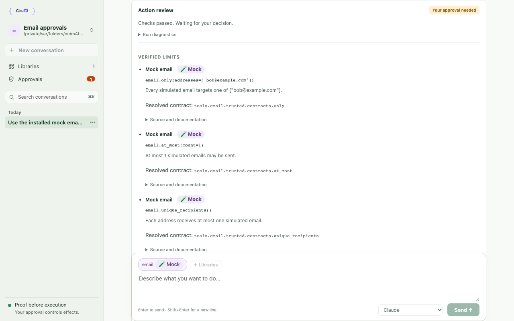
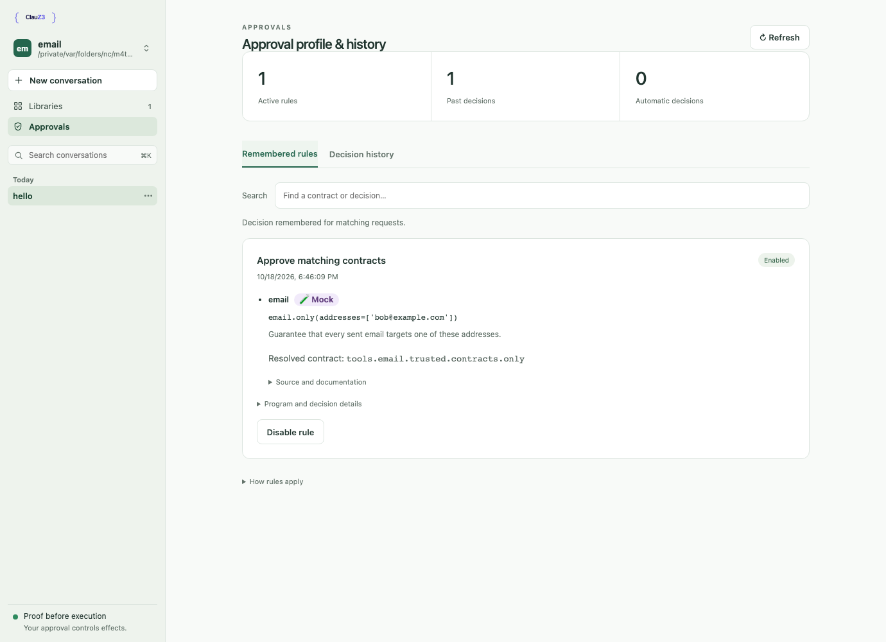
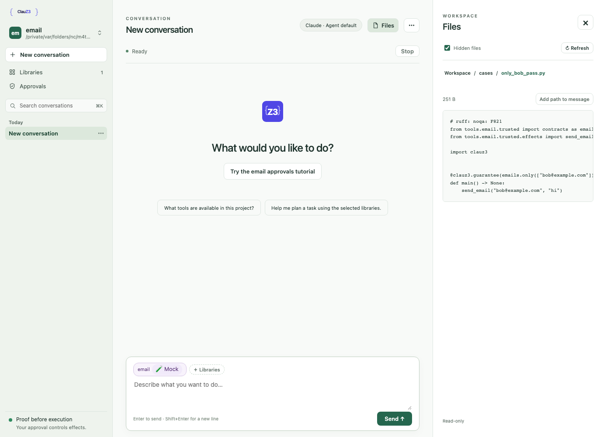
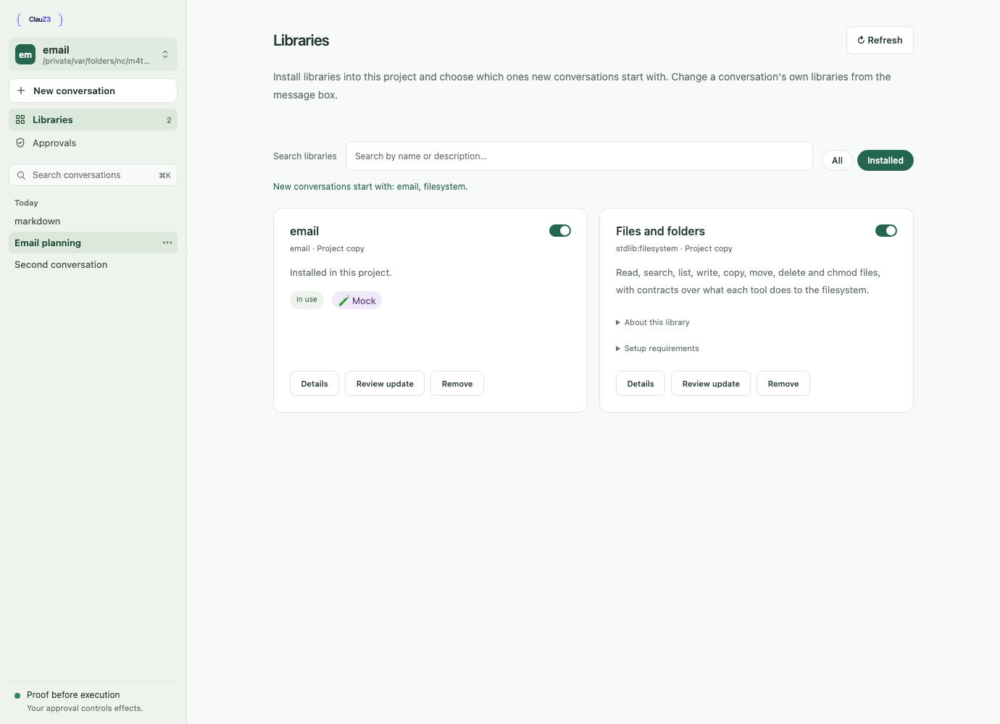

# Unified local workspace



`clauz3 ui [claude|codex|agy|opencode|pi]` composes the existing approval authority with a local agent
conversation. It follows AmiGO3's browser/WebSocket/ACP-stdio architecture and
server-owned process lifetime; the implementation lives in `sessions/chat.py`
and packaged `sessions/web/` assets. There is no frontend build step.

```text
Browser ── WebSocket ── Session host ── ACP/stdio ── Selected agent
   │                                                  │
   │                                           Clauz3 MCP tools
   │                                                  │
   │                                            proof/run worker
   │                                                  │
   └── approver cookie ── Approval authority ── signed receipt
```

Provider selection lives in `sessions/providers.py`. Codex and OpenCode use
external ACP runtimes; `native_adapter.py` maps Antigravity's stream-json and
Pi's SDK/RPC events into the existing host protocol. Pi's packaged `pi_bridge.mjs`
connects the six Clauz3 MCP tools. All provider runtimes are
optional executable dependencies. `terminal.py` reuses `Conversation` for the
non-Claude CLI frontend, including streaming, run state, cancellation, and
resume. Claude's native terminal launcher is unchanged.

Claude and pinned Pi support harness confinement. Other providers require
`--unrestricted`, which is persisted with the conversation and displayed in the
UI. Their native tools may bypass Clauz3. Provider and model identity are saved;
a different provider never receives another provider's session ID. Runtime or
authentication failures preserve the transcript. Provider switching is limited
to server-defined commands and starts a new conversation.
Claude's browser integration rejects `--unrestricted`, including switches from
an unrestricted workspace; its native terminal launcher still offers that mode.
Provider availability is cached per conversation and excluded from saved state.
Unavailable or unknown saved providers preserve their transcripts and allow the
operator to start another conversation.

Restricted Pi runs `restricted_pi.mjs` against the unmodified, installed
`@earendil-works/pi-coding-agent@0.82.1` SDK. Its `tools` allowlist filters both
model-visible tools and the executable registry. Clauz3 provides an empty
resource loader, in-memory settings, an isolated process environment, and an
auth-only model runtime; no discovery loader runs. The adapter checks the exact
tool inventory at startup and before each request. Only text prompts and a
session-state query are accepted by this private transport; native RPC bash,
configuration changes, and extension reload are unavailable. Fresh and resumed
sessions use the same configuration. `tests/test_pi_confinement.py` drives the
actual installed SDK with forced forbidden tool calls and hostile resources,
without network access or model credentials. Install the pinned optional runtime
to run that test; it skips when the runtime is absent or unsupported.
The `pi-confinement` CI job installs it explicitly and also tests real proofs,
signed approval, rejection, and cancellation through the SDK-to-MCP bridge.

The existing launcher discovers libraries, snapshots skill documents, checks the
MCP bridge, generates separate credentials, and starts the local service. UI
mode passes private configuration in a mode-0600 file inside the launcher's
private temporary directory. Only the service receives the signing key and
decision credential. The agent environment strips approval credentials; its
MCP configuration includes only submission credentials and the verification
key. No secrets are placed in the page or chat event history by the host.

The host performs ACP initialization and session creation, reconstructing all
session parameters itself. The browser submits text prompts and controls Stop
and New conversation. ACP updates remain protocol-shaped; `clauz3/user`,
`clauz3/turn_end`, `clauz3/state`, `clauz3/restore`, and `clauz3/notice` are local
workspace events. This endpoint is a constrained workspace transport, not a
transparent general-purpose ACP proxy. Native terminal/filesystem capabilities
are not advertised. Native tool permission requests are refused; configured Clauz3 MCP
tools are already allowed to invoke the proof workflow. Codex additionally
requests per-call MCP permission; only requests correlated with an announced
Clauz3 tool call and marked as MCP approval are accepted, using `allow_once`.
This grants entry to the bridge, never execution approval.

The Claude adapter version is deliberately pinned. Its `_meta.claudeCode.options`
extension forwards the SDK restriction settings. On the reviewed release,
`settingSources: []` becomes `--setting-sources=`, `tools: []` becomes
`--tools ''`, and strict MCP configuration and the six allowed tools reach the
underlying CLI. All browser-supplied SDK configuration is excluded.

Runner state uses an atomic JSON snapshot in the private session directory,
with bounded retained records. It carries run IDs, source hashes, phases,
diagnostics, and approval request IDs independently of agent narration and
optional ACP progress forwarding. The host associates each new run with the
current turn; another prompt is refused while either the agent or a run is
active. The UI joins these records to escaped, server-rendered approval cards
by exact request ID. It does not infer approval from a slow tool call or infer
execution from approval alone. Approval actions use the existing decision API.

Action reviews separate run status from individual proof diagnostics. The main
card shows the execution phase and any failure reason; the last checked
expression, proof conclusion, and exit code remain under **Run diagnostics**.
The **Verified limits** list shows the library title and declared Mock/Mixed badge,
the library-qualified call with named arguments, its trusted description (or
first docstring paragraph), and the full resolved Python symbol.
**Source and documentation** expands the original agent expression, captured
source, file/line, source and layer fingerprints, recorded origin/revision, and
full docstring. Live cards and saved history use the same ordering. Identity is
independently verified against the selected registration, separately from
description templates and eligibility for remembered approvals. Installing newer
libraries does not rewrite history. Records without a captured identity say
**Resolved identity not recorded**. See [contract descriptions](../reference/contract-descriptions.md).

Conversation events and run snapshots are stored in an operator-owned SQLite
file, `conversations.sqlite`, under the user-wide Clauz3 data directory. Records
are isolated by canonical project path. New conversation keeps the previous
transcript. The sidebar follows the chat-app pattern: workspace switcher, New
conversation, Libraries and Approvals (with installed and waiting counts), then
date-grouped history with search (⌘K) and a per-row menu for Rename and Copy
handoff. The conversation header's ⋯ menu adds Export transcript. Menus are
native popovers anchored by `menus.js`; grouping lives in `history.js`.
Drafts are kept per conversation in browser session storage. Each conversation
retains an 8 MB transcript limit, and the live subscriber queue remains bounded.
Reaching the storage limit stops retaining new events and disables further
prompts, while the current action continues to completion. The UI clearly marks
later output as unsaved; Stop remains available. Backpressure restores use a
snapshot of retained messages, so later events are not replayed twice.

One agent conversation runs at a time. Switching stops the previous agent and
uses ACP `session/load` to resume the selected adapter session, with freshly
constructed MCP credentials and the same server-controlled SDK restrictions.
The host suppresses adapter history replay because its saved transcript already
contains those messages. If the adapter cannot resume, the transcript remains
visible and the UI reports the error. Wait for an active action to finish or
use Stop before switching. An exclusive project lease prevents two UI services
from resuming the same project concurrently. The lease is acquired before
creating a conversation or resetting run state; the launcher reports a specific
already-open error. Server restarts reopen the most
recently updated conversation. CLI `clauz3 resume` continues to use its separate
managed-session metadata.

## Workspace selection and tutorials

`sessions/workspaces.py` keeps recently opened canonical paths in
`recent-workspaces.sqlite` beside the conversation database. Startup selects the
launch directory, unless `--tutorial` selects the bundled email tutorial.
An authenticated, same-origin `clauz3/workspace` WebSocket command selects an
existing folder or the hardcoded `email` tutorial; agents cannot invoke it.
The switcher opens a dropdown menu of recent workspaces, **Open folder…**, and
tutorials; stop and reset confirmations use a modal dialog. It stays available
during proof and approval work. The server requires
explicit stop confirmation when work is active, and refuses switches while a
library operation is mutating or preparing the workspace.

The destination's project lease is acquired before stopping the source agent.
Switching rebinds conversation storage, libraries, file browsing, and the
approval profile, then releases the previous lease. Submission credentials
rotate, pending approval requests are cancelled, and requests that finish
verification after the switch are rejected by a generation check. Each switch
uses a fresh run-status file to exclude late updates from old workers. The
browser reloads the chat view to discard old previews and approval polls.
There is one active workspace per process; no background workspace execution.

An explicit launch policy applies only to the launch project. Other projects
use their own remembered profiles; returning restores the explicit policy.
Custom skill snapshots apply only to the launch workspace and are restored
when returning there. Startup prompts are not replayed when switching. Agent runtime configuration remains owned by this UI process.

`src/clauz3/tutorials/email/` is a deliberately small, independently tested copy
of the developer example, shipped in the wheel. `examples/email/` retains the
fuller proof collection; the walkthrough stays in `docs/quickstarts/mock-email.md`.
The UI creates a writable copy under the user data directory's `tutorials/email/`,
never in an OS temporary folder or the launch project. Existing copies survive
updates. Confirmed reset replaces only that managed directory and clears its
conversation rows, library preferences, and approval profile. Reset acquires the
same project lease and rejects symlink destinations. It uses the current bundled
template. Reset does not erase separately exported handoff snapshots.

The bundled sender is a no-op. Its `@clauz3.mock` declaration drives the purple
**Mock** chip and menu badge; libraries with mixed declarations show **Mixed**.
The label itself is descriptive, not a sandbox. The tutorial has no outbox.
The inline introduction and starter prompts complement the documentation rather
than embedding a second walkthrough.

**Copy handoff** saves a mode-0600 JSON snapshot in `handoffs/` beside the
conversation database. The clipboard reference includes the conversation's
stable UUID, project, capture time, and absolute snapshot path. A developer
assistant on the same machine can read it after the UI stops, without a login
cookie. Each click creates a new snapshot; later turns do not change an earlier
handoff. The snapshot includes saved messages, raw tool calls and results,
run diagnostics, and conversation settings, but not the process configuration.
Requests are authenticated, origin-checked, and scoped to the current project.

Messages and responses have copy buttons; responses copy their original
Markdown, including streamed text received so far. Code blocks, tool results,
and raw tool data can also be copied independently.

The Approvals view shares a reusable component in `approvals/web/` with the
standalone `/ui/profile` page. It reads the existing profile API and keeps the
same remember/disable operations and authority checks. Navigation within the
workspace preserves the live chat connection and draft. Saved approval request details
can be shown with historical runs after a service restart; history does not
create approval grants or re-execute actions.



Stop kills the agent process group. A small `acp_worker` supervisor watches a
private lifetime pipe, so even abrupt service death stops the adapter and MCP
bridge. A private Unix socket also ties MCP bridges directly to the service,
including adapters that detach bridges into separate process groups. Each
proof/execution worker already watches its bridge's lifetime pipe
and terminates its separate process group if the bridge disappears. Advisory run-snapshot write failures do not interrupt
execution. Stopping cannot undo effects that completed before cancellation.

The browser WebSocket and transcript endpoint require the approver session,
a loopback peer and Host, and same-origin browser access. Chat content is
inserted with `textContent`; agent HTML is never interpreted. The approval
markup is generated and escaped by the existing service. No third-party scripts,
remote images, or fonts are loaded. Explicit ACP startup errors survive cleanup;
malformed responses terminate the failed adapter rather than leaving a stuck UI.
Raw adapter stderr remains excluded from the UI and history because it may
contain credentials. Authentication failures close the WebSocket with 1008;
another active tab gets the retryable 1013 code.

## File browser



The **Files** button opens a read-only browser alongside the conversation (a
full-width panel on small screens). Browse folders, use the breadcrumbs to go
back, toggle hidden files, and refresh to pick up changes. UTF-8 files have an
inert text preview; **Add path to message** inserts the workspace-relative path
into your unsent draft. This does not send the file contents to the agent.

The `/api/workspace/files` endpoint shares the transcript endpoint's operator
session and same-origin checks. The server supplies the active workspace root
on each request. Each path component is opened relative to an existing directory file
descriptor with `O_NOFOLLOW`, so links and parent traversal cannot escape the
root, including when a path is swapped during a request. Symbolic links and
special files are unavailable. Listings are limited to 2,000 entries and text
previews to 256 KB; binary and non-UTF-8 files show metadata only. File content
is returned as uncached JSON and inserted with `textContent`, never rendered
as HTML. Files cannot be edited or deleted through this browser.

## Library management

Library descriptions and setup are read from domain manifests plus installed
package snapshots; see [Library manifests and setup](../reference/library-manifests.md).
An installation review includes a `warnings` array. The UI displays missing
domain-manifest notices without disabling installation of legacy libraries.
An absent optional package manifest does not produce a notice. Invalid metadata
or a declared package with a missing domain manifest fails preparation instead.



The Libraries view uses `libraries/workspace.py` over the existing catalogue
and CLI installer. Empty workspaces open this view automatically, without a
terminal chooser. Operators can search bundled, curated, and configured global
sources, inspect installed APIs, and review staged source, file changes, and
runtime requirements before confirming installation or replacement. Installing
a library does not install external runtimes or authenticate accounts.

The Libraries view is one list of cards with All and Installed filters. Each
installed card's switch sets the default for new conversations, saved per
canonical workspace with declared dependencies included. A conversation records
its own domains and a content fingerprint, shown as chips above the message box.
The chips' menu changes them: before the first message freely; afterwards by
restarting the agent and resuming the same session with a rebuilt MCP bridge
and approval authority. Removing libraries applies at once. Adding libraries or
continuing after their files changed asks first, then pauses automatic
approvals (remembered allow rules and `--policy` allows) for the rest of that
conversation, since earlier messages may carry injected instructions; automatic
rejections still apply. Every change in a started conversation adds a
transcript marker, and the agent's next prompt starts with a note listing every
change since its last prompt.
Agent messages cannot select or install libraries. See
`docs/superpowers/specs/2026-10-14-library-selection-design.md`.

Library endpoints require the operator cookie, loopback access, and same-origin
checks; mutations require an explicit matching Origin header. Source identifiers
must come from the server catalogue. Review stages the existing installer's
output and validates declared domains; apply rechecks file hashes and refuses
symlinks, overlapping trees, or changes to active libraries. Updates and removals
retain originals under `.clauz3/library-backups/<review-id>/`, with rollback if a
move fails. Selection and conversation changes are blocked while an operation
is in progress. Install review parses source without importing library code. Git subprocesses
retain operator Git authentication but receive no approval credentials, signing
keys, or internal workspace configuration.

## Verification

```bash
uv run pytest tests/test_workspace_switching.py tests/test_workspace_libraries.py tests/test_workspace_files.py tests/test_workspace.py tests/test_start.py tests/test_session_runs.py
just check
# Optional browser smoke check; install Chromium first if needed:
uv run --with playwright playwright install chromium
uv run --with playwright python scripts/check_workspace_browser.py
```

The deterministic ACP fixture checks SDK configuration and credential
separation and can invoke the real Clauz3 MCP/prover/receipt pipeline against
the mock email example. The browser check covers streaming, inert HTML,
reload and draft recovery, pending approval across reload, execution after
approval, export, Stop, switching/resuming/renaming conversations, service
restart recovery, approval profile curation, file browsing, library installation,
selection and removal, tutorial entry/reset, active workspace switching, approved execution with newly selected roots, and mobile overflow. It sends no
model requests. Screenshots are written under `/tmp/clauz3-workspace-*.png`;
the Files, Approvals and Libraries images in this page come from that run.

`just docs-videos` re-records the tutorial video, README GIF and the screenshot
at the top of this page. Unlike the check above, it runs the real
`clauz3 ui --tutorial` with your default agent, so it needs that agent's login
and makes model requests. It uses a temporary data directory and fast-forwards
the agent's thinking time with ffmpeg.

An additional local check initialized `claude-agent-acp` 0.89.1 and created a
session with the configured MCP server, capturing the spawned CLI arguments to
verify restriction forwarding. No model prompt was sent in that check.
