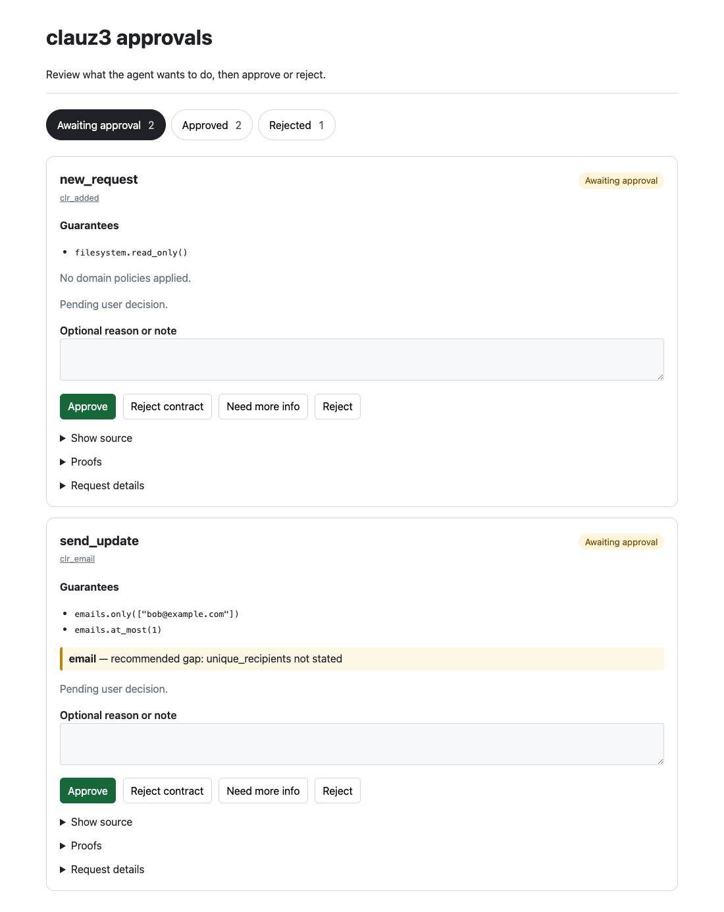
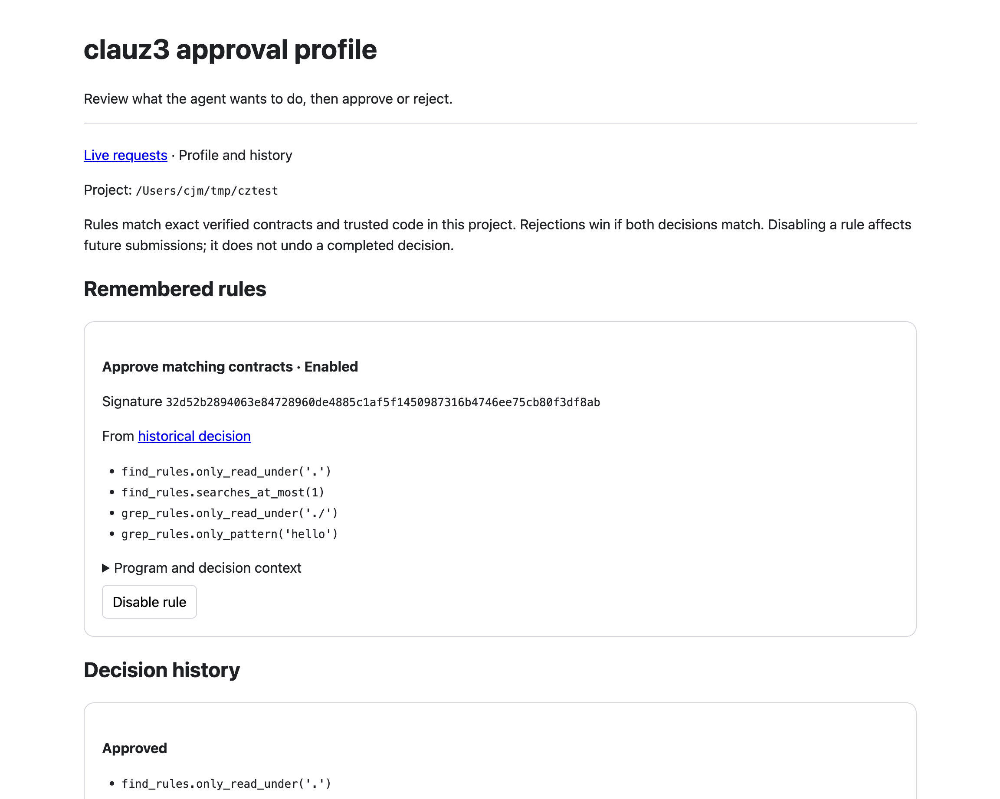

# Approval Service

For an agent session, use `clauz3 start claude` from a folder containing an
installed trusted layer. It starts this service, opens the approval UI, and
provisions credentials for the restricted agent automatically. See
[`clauz3 start`](../reference/cli.md#clauz3-start). The instructions below are
for operating the service separately or integrating another harness.

`clauz3 run` has a separate approval step between proof and execution. The
approval service is the user-controlled process that receives the proved
program, shows the contract and code, records the user's decision, and returns
that decision to `clauz3 run`.

The important trust-boundary rule is that the agent should not own this process.
An agent may write the program and guarantees, but a user or harness should
start and inspect the approval service.

## Runtime flow

`clauz3 run` follows this order:

1. Parse and prove the requested target, `main` by default.
2. Stop immediately if any proof fails. No approval request is submitted.
3. Build a JSON approval request containing the program, declared guarantees,
   proof summaries, trusted roots, import roots, and program hash.
4. `POST` that request to the configured approval service.
5. The approval service records the request as pending and shows it in the UI.
6. The user approves or rejects the request, optionally with a reason.
7. The original `POST` returns that decision and a signed receipt to `clauz3 run`.
8. `clauz3 run` verifies the receipt's signature against the provisioned public
   key and checks that it is bound to this exact program, request, and the
   guarantees the user saw — then executes the target only if the decision is
   approved. It **refuses to run** if no verifying key is configured.

The approval artifact is the verified contract, not the agent's prose summary.
The program source is included for inspection and shown behind an expandable
section in the bundled UI.

## Review requests without leaving the list

The browser opens on **Awaiting approval**. Each card shows the declared
guarantees and coverage, with approval controls on the same page. Expand the
source, proofs or request details when needed. **Approved** and **Rejected**
show decisions from the current service session, including policy decisions
and requests for more information.

The page refreshes as requests arrive and decisions change. Unchanged cards
retain typed notes, keyboard focus and expanded details. Connection and
expired-login errors are shown in the page; a failed decision leaves the note
available to retry. These tabs show the current service session; **Profile and
history** shows persistent history for ordinary `clauz3 start` sessions.



## Remember decisions across sessions

In a `clauz3 start` session, eligible cards offer **Approve and remember** and
**Reject and remember**. These remember the verified contract, so a revised
program with the same guarantees can receive the same decision. Approve and
Reject alone remain one-time decisions.

The service independently proves each program in a worker with a 20-second
deadline. It verifies the submitted source hash, guarantees and coverage before
matching. A timeout, failed proof, incomplete verification, or unsupported
signature leaves the request for manual review without remember controls.
Programs without explicit guarantees and contracts with Row-class arguments
are not eligible in this version.

Matching is deliberately exact: project directory, operator, target, guarantee
expressions, import bindings, coverage, trusted source and dependency identities,
and proof engine identity must match. Changes to source inside the function can
match; changing a bound, project, library or engine requires another decision.
Equivalent aliases or expressions may conservatively require another approval.
Remembering a weak guarantee does not make it stronger. Review the complete
contract and coverage before remembering it.

**Profile and history** shows this project's rules and past requests. A human
approval or rejection can be included later, and its contribution can be
excluded or disabled. An enabled rejection wins over an enabled approval with
the same signature. Disabling one contribution leaves other matching rules in
place. Rule changes affect subsequent submissions, not decisions already made
or requests already waiting for human review. Automatic decisions record the
matching rule and receive fresh, program-bound receipts.

The SQLite store is `approval-history.sqlite` inside `CLAUZ3_HOME`, otherwise
`$XDG_DATA_HOME/clauz3`, otherwise `~/.local/share/clauz3`. History includes
submitted source and verified context, but excludes service credentials and
execution receipts. Treat it as private data. It survives service shutdown;
the service and its credentials remain ephemeral.



The store is operator-owned policy authority, just like an explicit policy
file or trusted library. Keep it outside the agent's writable scope and do not
approve effects that modify it. File permissions do not isolate processes
running under the same OS user; `clauz3 start` is not an OS sandbox. Stronger
isolation requires a separately protected operator account/service.

Explicit `--policy` sessions use that policy alone: profile composition is
deferred so a remembered permission cannot bypass a mandatory policy. The
standalone `approval-service` command keeps its existing manual/policy behavior.
General rule editing, entailment-based matching, profile analysis, and history
search are future work.

## Current local service

The bundled `clauz3 approval-service` is a small localhost FastAPI service with
a REST API and browser UI. It keeps requests and decisions in memory. It is
meant for local demos, integration tests, and harness-controlled approval
experiments.

Bind it to `127.0.0.1`. The state-changing endpoints require a bearer token by
default (see below), and it keeps requests in memory only — add your own
storage and network controls before exposing it beyond localhost.

## Receipt signing keys (required)

`clauz3 run` is fail-closed: it verifies a cryptographic receipt before
executing and refuses to run without a verifying key. The service signs each
approved receipt with an Ed25519 **private** key; the runner holds only the
matching **public** key, so nothing in the runner's process (where the approved
program executes) can forge a receipt.

Generate a keypair once:

```bash
uv run clauz3 approval-keygen
```

It prints two assignments. Provision the **signing** key where the service runs
and the **verifying** key where `clauz3 run` runs:

```bash
# in the approval service's environment — keep secret:
export CLAUZ3_APPROVAL_SIGNING_KEY=...
# in the clauz3 run environment:
export CLAUZ3_APPROVAL_VERIFY_KEY=...
```

The receipt is bound to the program hash, the request id, and a digest of the
proved guarantees and coverage. A receipt for one program (or one set of
contracts) cannot be replayed for another, and each receipt is single-use.

## Start the service

From a project or example directory:

```bash
uv run clauz3 approval-service --host 127.0.0.1 --port 8765
```

Command-line arguments:

| Argument | Default | Meaning |
| --- | --- | --- |
| `--host HOST` | `127.0.0.1` | Host address to bind. Use localhost for normal use. |
| `--port PORT` | `8765` | TCP port to listen on. |
| `--policy PATH` | none | Operator-authored JSON rules for automatic decisions. Requires explicit root configuration below. |
| `--trusted-root PATH` / `--trusted-roots PATH ...` | none | Ordered trusted roots the operator allows policy evaluation to load. |
| `--import-root PATH` / `--import-roots PATH ...` | current directory | Ordered import roots for that authorized layer. |
| `--no-auth` | off | Disable both credentials: anyone who can reach the port can submit, view, and decide. Receipt signing is unaffected. Localhost demos only. |

Without `--policy`, decisions come from the user through the UI or decision API.
The service does not import code from the request's roots in this mode.

By default the service uses two separate credentials:

| Credential | Held by | Authorizes |
| --- | --- | --- |
| Submission token (`CLAUZ3_APPROVAL_TOKEN`) | `clauz3 run` | `POST /requests` only. |
| Approver token (`CLAUZ3_APPROVAL_DECISION_TOKEN`) | the person or tool that decides | Recording a decision, and the browser UI. |

The service reads each token from its environment variable, or generates one
and prints it. The two must differ. The runner presents the submission token
(set `CLAUZ3_APPROVAL_TOKEN` in both environments); it never needs the approver
token, so a process that has only what the runner has cannot approve its own
request. No page the service serves contains either token. Pass `--no-auth`
only for a localhost demo.

On startup the service prints the environment variable values that `clauz3 run`
can use, and a private sign-in URL for the approver:

```text
CLAUZ3_APPROVAL_SERVICE=http://127.0.0.1:8765
CLAUZ3_APPROVAL_TOKEN=<generated-or-configured-token>
approver UI (keep private): http://127.0.0.1:8765/ui/login?key=<approver-token>
```

Opening the sign-in URL sets an `HttpOnly`, `SameSite=Strict` session cookie
and redirects to the request list; the UI then authenticates with that cookie.
A script that decides requests sends `Authorization: Bearer <approver-token>`
to the decision endpoint instead.

Open the browser UI through the printed sign-in URL. Under `--no-auth` the UI
is open at `http://127.0.0.1:8765/`.

## Authorize a layer for automatic decisions

Policy evaluation imports trusted Python while checking the submitted program.
The service operator must authorize that code before a request can select it.
Start an email policy service from `examples/email` with explicit roots:

```bash
uv run clauz3 approval-service --policy approval-policy.json \
  --trusted-root tools/email/trusted --import-root .
```

Use the same roots when submitting a program from another terminal in the same
directory, after configuring its service URL, bearer token, and verifying key:

```bash
uv run clauz3 run cases/only_bob_pass.py \
  --trusted-root tools/email/trusted --import-root .
```

The service requires an exact match of both ordered root lists after resolving
paths. Request fields select a configured layer; they cannot grant authority to
load another directory. Extra or reordered roots are rejected with HTTP 403
before initialization, including policies with empty clauses and requests with
a previously recorded decision. Relative request paths resolve from the
service's working directory; use absolute paths when the two processes have
different working directories.

Cached approvals belong to the selected authorized layer. Reusing a request ID
with a different configured layer re-evaluates the policy. If that replaces a
request still awaiting a human decision, the older submission returns HTTP 409
rather than receiving the other layer's approval.

With `--policy`, at least one root flag must be explicit. Trusted roots are never
discovered automatically by the service. A policy needing no trusted modules
can explicitly configure just `--import-root .`. Protect all code reachable
through the configured roots from requester modification: authorizing paths
does not sandbox Python or make mutable files safe.

For large trusted dependency graphs, the operator can raise
`CLAUZ3_MAX_DEPENDENCY_MODULES` and `CLAUZ3_MAX_DEPENDENCY_AST_NODES` in the service
and runner environments. The defaults are 256 modules and 500,000 source nodes
per retained dependency closure. A limit refusal falls back to a human decision;
it never skips verification to grant approval. See
[trusted dependency work limits](../reference/python-subset.md#trusted-dependency-work-limits).

Python hosts can configure several exact layers with
`create_approval_app(..., authorized_layers=(...))` or
`serve_approval_service(..., authorized_layers=(...))`. Each entry is an
`ApprovedLayer` from `clauz3.approvals.authority`:

The earlier `clauz3.approval_authority`, `clauz3.approval_policy`, and
`clauz3.approval_service` imports remain available for existing hosts.

```python
from pathlib import Path

from clauz3.approvals.authority import ApprovedLayer
from clauz3.approvals.policy import load_approval_policy
from clauz3.approvals.service import create_approval_app

email = Path("/srv/clauz3/email")
app = create_approval_app(
    policy=load_approval_policy(email / "approval-policy.json"),
    authorized_layers=(
        ApprovedLayer(
            trusted_roots=(email / "tools/email/trusted",),
            import_roots=(email,),
        ),
    ),
    auth_token="replace-with-the-operator-token",
)
```

The Python APIs default to an empty registry, which authorizes no policy
evaluation. Direct `evaluate_policy` calls also require `authorized_layers`.
See [Approval policies](../todos/approval-policies.md) for rule syntax and local
policy checks.

## User decisions

The bundled UI offers these decision paths:

| Decision | Meaning |
| --- | --- |
| `approved_once` | Approve this exact request and issue a receipt. |
| `rejected_contract` | Reject because the proved contract says the program will do something the user does not want. |
| `request_more` | Reject for now because the contract or explanation is too vague. The agent should revise and submit a new request. |
| `rejected` | Reject without a more specific subtype. |

Only these approved decisions let `clauz3 run` execute:

- `approved_once`
- `approved_remember`
- `auto_approved`

All other decisions are treated as not approved. The current UI issues
`approved_once`; future policy layers may issue `approved_remember` or
`auto_approved`.

The optional reason field is stored as `feedback` in the JSON response. It is
user-authored decision text, not startup config.

## REST and UI routes

| Route | Method | Purpose |
| --- | --- | --- |
| `/health` | `GET` | Health check. |
| `/` or `/ui` | `GET` | Browser request list. |
| `/requests` or `/api/requests` | `POST` | Submit an approval request and wait for a decision. |
| `/requests` or `/api/requests` | `GET` | List recorded requests. |
| `/requests/{request_id}` or `/api/requests/{request_id}` | `GET` | Fetch one recorded request. |
| `/requests/{request_id}/decision` or `/api/requests/{request_id}/decision` | `POST` | Record the user decision. Needs the approver token or session. |
| `/ui/requests/{request_id}` | `GET` | Browser detail view for one request. Needs an approver session. |
| `/ui/login?key=<approver-token>` | `GET` | Exchange the approver token for a browser session cookie. |

The decision API accepts JSON:

```json
{
  "decision": "request_more",
  "feedback": "The contract should say exactly which files will be written."
}
```

For approved decisions, the service returns a signed receipt, using the Ed25519
signing key from its environment (`CLAUZ3_APPROVAL_SIGNING_KEY`). Without a
signing key it falls back to an unsigned `local-<request_id>` placeholder, which
a fail-closed runner will reject — provision the keypair (see above).

## Connect `clauz3 run`

`clauz3 run` discovers the approval-service URL in this order:

1. `CLAUZ3_APPROVAL_SERVICE`
2. `CLAUZ3_APPROVAL_URL`
3. `.clauz3/approval-service.json` in the current working directory

The recommended path for interactive use is to export the value printed by the
service, along with the verifying key (and the bearer token, unless the service
was started with `--no-auth`):

```bash
export CLAUZ3_APPROVAL_SERVICE=http://127.0.0.1:8765
export CLAUZ3_APPROVAL_VERIFY_KEY=...   # the public key from approval-keygen
export CLAUZ3_APPROVAL_TOKEN=...        # match the service's token, if auth is on
```

For a repo-local discovery file:

```bash
mkdir -p .clauz3
printf '%s\n' '{"url": "http://127.0.0.1:8765"}' > .clauz3/approval-service.json
```

The `.clauz3/approval-service.json` file must contain a non-empty string `url`.
It is read by `clauz3 run`; it is not passed to `clauz3 approval-service`.

Example run from `examples/email`:

```bash
uv run --project ../.. clauz3 run cases/only_bob_pass.py
```

`clauz3 run` waits for user approval. The default wait is 300 seconds and can be
changed with:

```bash
uv run clauz3 run --approval-timeout 600 plan.py
```

If no approval-service URL is configured, `clauz3 run` exits with:

```text
error: no approval service configured; set CLAUZ3_APPROVAL_SERVICE
```

## Mock approval service

`clauz3 mock-approval-service` is the config-driven service. Use it for tests,
automation, and local demos where no user will click the UI.

Start it with a JSON decision config:

```bash
printf '%s\n' '{"decision": "approved_once"}' > approval.json
uv run clauz3 mock-approval-service --config approval.json --port 8765
```

Mock command-line arguments:

| Argument | Required | Default | Meaning |
| --- | --- | --- | --- |
| `--config PATH` | yes | none | JSON decision config described below. |
| `--host HOST` | no | `127.0.0.1` | Host address to bind. |
| `--port PORT` | no | `8765` | TCP port to listen on. |

Mock config keys:

| Key | Type | Meaning |
| --- | --- | --- |
| `decision` | string | Decision returned to `clauz3 run`. Defaults to `approved_once` when omitted. |
| `receipt` | string | Optional verbatim receipt returned for approved decisions. When omitted, the mock signs a valid receipt if `CLAUZ3_APPROVAL_SIGNING_KEY` is set, else returns an unsigned `mock-<request_id>` (which a fail-closed runner rejects). |
| `feedback` | string | Optional mock feedback returned with the decision. |
| `require_program_sha256` | string | Optional exact program hash gate. If the request hash does not match, the mock returns `rejected`. |

Example mock denial:

```json
{
  "decision": "request_more",
  "feedback": "Add a guarantee that recipients are unique."
}
```

The mock server supports `POST /requests` and prints
`CLAUZ3_APPROVAL_SERVICE=...` on startup, but it does not provide the FastAPI
browser UI or request-list routes.

## Protocol shape

A `clauz3 run` request looks like this:

```json
{
  "schema_version": 1,
  "kind": "clauz3.run",
  "request_id": "clr_...",
  "program_sha256": "...",
  "source_name": "cases/only_bob_pass.py",
  "target": "main",
  "trusted_roots": ["tools/email/trusted"],
  "import_roots": ["."],
  "guarantees": ["emails.only(['bob@example.com'])"],
  "proofs": [
    {
      "name": "main",
      "conclusion": "proved!",
      "description": "assertion, guarantee"
    }
  ],
  "program": "..."
}
```

The service response must be a JSON object with at least a string `decision`:

```json
{
  "decision": "approved_once",
  "request_id": "clr_...",
  "receipt": "clz2.<payload>.<signature>"
}
```

For approved decisions, `clauz3 run` requires a receipt whose Ed25519 signature
verifies against `CLAUZ3_APPROVAL_VERIFY_KEY` and that is bound to this exact
program, request, and proved guarantees; otherwise it refuses to execute. For
not-approved decisions, `clauz3 run` exits without executing and prints the
decision plus any feedback.

## Troubleshooting

`error: no approval service configured; set CLAUZ3_APPROVAL_SERVICE`

: The service URL is not visible to `clauz3 run`. Export the printed
  `CLAUZ3_APPROVAL_SERVICE=...` value, or create
  `.clauz3/approval-service.json` with a `url` key.

`error: refusing to run: no approval verifying key provisioned`

: `clauz3 run` is fail-closed and has no public key to verify the receipt.
  Run `clauz3 approval-keygen` and export `CLAUZ3_APPROVAL_VERIFY_KEY` (and set
  `CLAUZ3_APPROVAL_SIGNING_KEY` where the service runs).

`error: receipt signature did not verify` / `receipt is not bound to ...`

: The receipt is unsigned, signed by a different key, or bound to a different
  program/request/contract set. Confirm the service has the matching
  `CLAUZ3_APPROVAL_SIGNING_KEY` and the runner has the paired
  `CLAUZ3_APPROVAL_VERIFY_KEY`.

`error: HTTP 401` from the approval service

: The service requires a bearer token the runner did not send. Set the same
  `CLAUZ3_APPROVAL_TOKEN` in both environments, or start the service with
  `--no-auth` for a localhost demo.

`error: HTTP 403` for an unauthorized trusted layer

: The request's trusted and import roots do not match an operator-configured
  layer. Use the same complete root lists in the same order on the service and
  runner. Explicit `--import-root` flags avoid the runner adding its default
  entry-parent root. The service operator must review a new layer before adding
  it to the configuration.

`approval service is unavailable`

: The approval service is not running, the URL points at the wrong port, or the
  service stopped before the user decision was recorded.

`approval: request_more`

: The user or mock service responded with a not-approved decision. Read the
  printed feedback or inspect the request in the browser UI, strengthen the
  program guarantees, and run again.
