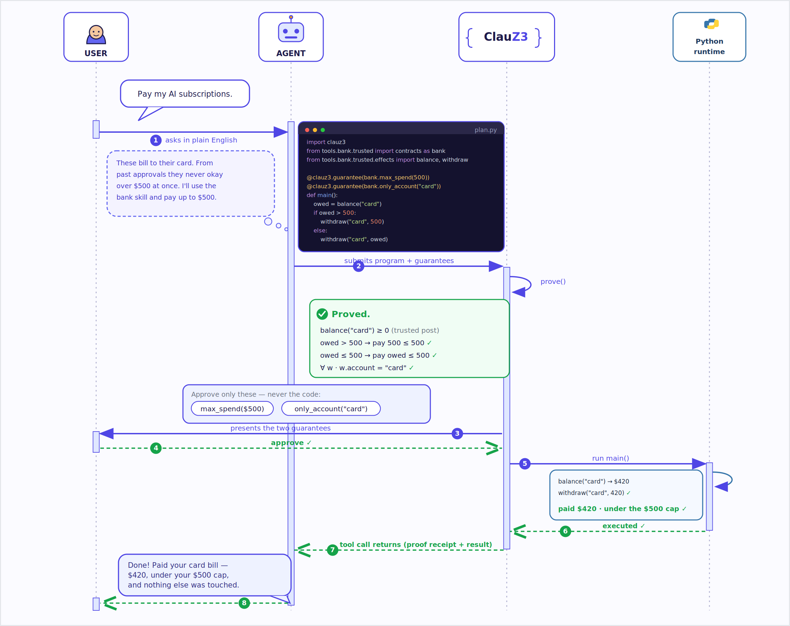

  
  

# ClauZ3

Verifiable contracts for agent-authored Python.

## Try it

Start with [mock email](quickstarts/mock-email.md): ask an agent to send a
message, review its proved guarantees, and approve a sender that does nothing.
Then try [real file work](quickstarts/real-files.md): install a library,
approve a file write, inspect the result, and count its lines.

<video src="assets/videos/tutorial.mp4" poster="assets/workspace-ui.png" controls autoplay muted loop playsinline width="100%"
       aria-label="The email approvals tutorial: the agent submits a program to send one mock email, an approval card lists its proved guarantees, the user approves, and the program runs."></video>

*The email approvals tutorial in the browser workspace. Time spent waiting for
the agent is sped up.*

Both quickstarts use the browser workspace for chat and inline approvals,
with a terminal alternative. The explanation and reference guides below
describe how the workflow works.

## Why guarantees?

Today an agent that wants to act in the world either asks you to click
"Allow" on every tool call, or gets a blanket grant like "may use email".
ClauZ3 asks once, and asks a better question:

> This program will email only `bob@example.com`, at most once. **Approve?**

The agent writes a small Python program and attaches guarantees about its side
effects. A Z3-backed prover checks those guarantees against *every* branch of
the program before anything runs. You approve the guarantees; the program runs
only after that, all or nothing.

The guarantees are the thing the user is asked to accept. The program is still
available for inspection, but a user should not have to read every branch to
answer questions like:

- Will this email anyone other than Bob?
- Will this email the same person twice?
- Will this spend more than $500 in total?
- Will this write outside a sandbox?

New here? [How ClauZ3 compares](explanation/comparison.md) sets it against
permission prompts, sandboxes, guardrails, and runtime policy monitors on one
page.

## Example

The user asks for a bill to be paid (capped); the agent
writes a program that looks up the outstanding balance and pays
`min(balance, $500)`; ClauZ3 proves the spend stays under the cap on *every*
branch and that only the named account is touched; the user approves the
*guarantees*, not the code; only then does the runtime execute it.

  

## How it fits together

Projects split into two layers:

- **Trusted roots** such as `tools/email/trusted/`: small audited modules
  containing side-effecting functions and reusable domain contracts. The prover
  trusts their signatures, `@clauz3.trusted` effect declarations,
  `@clauz3.requires(...)` preconditions, and `@contract` helper definitions.
- **Agent-authored code**: ordinary Python that imports trusted functions and
  adds `@clauz3.guarantee(...)` decorators to the function being proved.

Trusted calls bottom out into symbolic effect facts that domain contracts can
query as relations.

## Where to go next

- [How ClauZ3 compares](explanation/comparison.md) — one-page comparison with
  permission prompts, sandboxes, guardrails, and policy monitors.
- [Background and related work](explanation/background.md) — the long-form
  comparison with proof-carrying code, CaMeL, FORGE, Guardians, Dogwood,
  and neuro-formal verification.
- [Effect specs](reference/effect-specs.md) — the relation algebra over
  trusted-call facts and its current primitives.
- [Coverage policies](reference/coverage-policies.md) — how a trusted layer
  flags or enforces the guarantees an agent should make about a domain it
  uses.
- [ClauZ3 Python subset](reference/python-subset.md) — supported language
  for both agent code and contract lambdas.
- [Approval service](how-to/approval-service.md) — user-controlled approval
  boundary, startup, URL discovery, command-line arguments, and REST/UI
  routes.
- [Integration testing](how-to/integration-testing.md) — black-box recipe
  for `clauz3 run` against a localhost approval service.

For the full README with worked examples and the current status of the
prover, see the
[project README on GitHub](https://github.com/normalform-ai/clauz3#readme).

## Built on

  
  &nbsp;&nbsp;
  

ClauZ3 layers on two upstream projects and would not exist without them:

- **[deal](https://deal.readthedocs.io/)** — the Python runtime contract
  engine `@clauz3.requires` / `@clauz3.ensures` are built on, so every
  condition a trusted layer states is also enforced at execution. A layer can
  use deal directly to bound what its own *bodies* may do; see
  [Extra runtime enforcement with deal](how-to/deal.md).
- **[Z3](https://github.com/Z3Prover/z3)** — Microsoft Research's SMT solver,
  the back-end the prover compiles every guarantee into. The vendored
  `deal-solver` machinery is what bridges Python AST and Z3 constraints.
