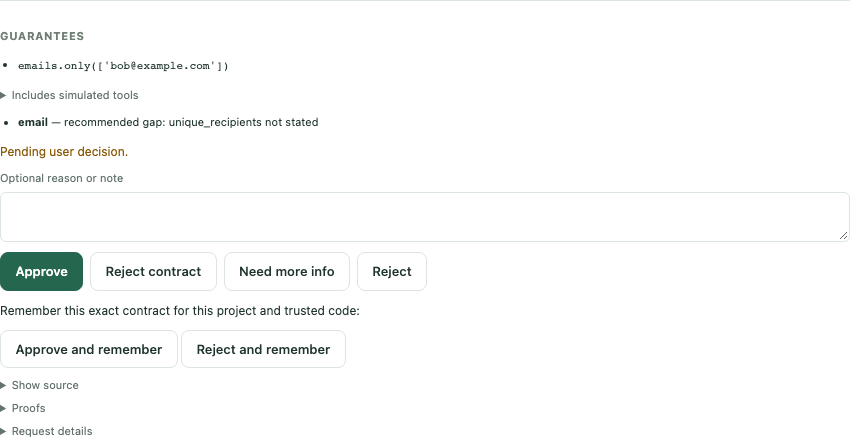

# Approve a mock email

See the approval workflow without sending an email: ask Claude to use the
repository's mock sender, inspect the guarantees, and approve the request.
Proofs, approval decisions and execution receipts are real; the sender's
implementation does nothing.

## Open the tutorial

No repository checkout is needed. Install [uv](https://docs.astral.sh/uv/),
Node.js 22 or later, and an authenticated Claude Code installation, then:

```bash
npm install -g @agentclientprotocol/claude-agent-acp@0.89.1
uvx clauz3 ui --tutorial
```

When running the development checkout before this feature is released, use
`uv run clauz3 ui --tutorial` instead. The command above requires a release
containing the bundled tutorial.

ClauZ3 opens a local browser workspace with chat and approvals together.
The tutorial needs your agent's usual authentication, but no email account,
Gmail setup, or email credentials. Restricted Pi is also supported with
`clauz3 ui pi --tutorial`; tutorials do not run with `--unrestricted`.

You can also run `uvx clauz3 ui` from your own project and click **Try the email
approvals tutorial** on the new-conversation screen, or choose **Tutorials →
Email approvals** in the top-left workspace menu. Opening the tutorial leaves that project's libraries and settings alone.

The tutorial installs its small bundled mock email library into a persistent,
managed workspace under `~/.local/share/clauz3/tutorials/email/` (or
`$CLAUZ3_HOME/tutorials/email/`). The library is selected for new conversations.
The composer chip and library picker show a purple **🧪 Mock** badge; **Mixed**
means a library contains both declared mock and unmarked effects. These labels
record the author's declarations; they do not enforce isolation.
The bundled sender does nothing. You can inspect its
`tools/email/trusted/effects.py` through **Files**.

The agent can discover selected tools and submit programs for proof and
approval. It cannot directly send email or install another trusted library.

## Ask for an email

Click **Send a mock email**, or paste this into chat:

> Use the installed email library to send bob@example.com the message
> "Hello from ClauZ3". Guarantee that only Bob can be emailed, there is at
> most one email, and recipients are unique. Submit it for approval.

The agent writes a small program. Watch its run progress through proof to
**Pending user decision**. An approval card appears in the conversation.

Check for these guarantees in the approval card:

- `email.only(addresses=['bob@example.com'])`
- `email.at_most(count=1)`
- `email.unique_recipients()`

The card resolves the agent's import aliases and names each parameter. It also
shows the description and full Python symbol, such as
`tools.email.trusted.contracts.at_most`. Expand **Source and documentation** to
see the original expression, source snapshot, fingerprints, and full docstring.

Expand **Show source** or **Proofs** if you want to inspect the details. If
one of the requested guarantees is missing, choose **Need more info** and
ask the agent to include it before approving.



*An example card. This one states only the recipient guarantee, so it also
flags the missing recommended `unique_recipients` guarantee. Your card should
include all three guarantees requested above.*

## Approve and see the result

Click **Approve**. The runner verifies the signed approval and calls the mock
sender. The agent should report completion. No email arrives: the implementation
is a no-op. There is currently no simulated outbox to inspect.

To try the other path, request another mock email and click **Reject**. The
program is not executed, and the decision is returned to the agent.

**Approve and remember** saves a decision for matching future contracts in
this project with the same trusted code. It does not approve every future
email request. The **Approval profile & history** link lets you inspect and
remove remembered rules. See [approval profiles](../how-to/approval-service.md) for matching
and storage details.

## Reset, leave, or continue

Use the top-left workspace picker to return to your project or open another
existing folder by absolute path. Recent folders are remembered across launches.
When work is active, switching offers **Stop and switch**; the previous
conversation's history is saved. Only one workspace runs in each UI process.

**Reset tutorial** asks for confirmation, stops active work, and replaces the
tutorial's files, conversations, and remembered approval rules. Other workspaces
are unaffected. The working copy survives restarts until you reset it; package
updates do not overwrite an existing copy. Reset picks up the current template.


**Stop** ends the active agent and workers. Press Ctrl-C in the terminal that
launched `clauz3 ui` to stop the service. Chat history survives service restarts.

Next, try [real file work](real-files.md), where approval produces a file you
can inspect. For how proofs relate to trusted implementations, read
[Concepts](../explanation/concepts.md) and
[mock declarations](../reference/effect-specs.md#declaring-mock-implementations).
An enforced demo mode with a simulated outbox is tracked separately in
[issue #320](https://github.com/cmungall/agent-deal/issues/320).

## Prefer a terminal agent?

Advanced users can still use the full developer example in a repository
checkout. From `examples/email`, run this instead of `clauz3 ui`:

```bash
cd examples/email
```

Then:

```bash
clauz3 start claude
```

Enter the same prompt in Claude's terminal. Approvals appear in the browser
opened by ClauZ3. Exiting Claude stops its approval service. The printed approver
URL grants access to approval decisions; keep it private.
