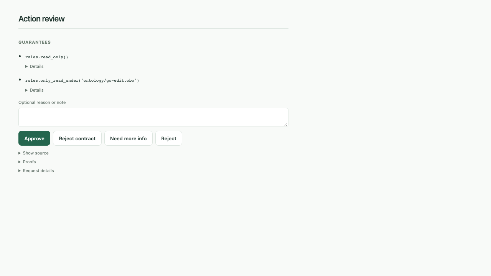

# Contract descriptions and LinkML

Verified approval requests can show a deterministic sentence above each
contract expression. The full trusted docstring remains visible beneath it.
For example, `rules.only_read_under('test.md')` displays:

> Every filesystem.read_file or filesystem.read_lines path must start with "test.md".

This describes the actual string-prefix policy: it also permits
`test.md.bak`. It is not an exact-file or resolved directory-containment rule.
Descriptions name the specific effects they constrain; the coverage panel
continues to show which other effects have guarantees.

## Define a trusted description

The existing `@contract` form still works. A trusted library can opt in with
a `description` argument:

```python
@contract(description="Every filesystem.read_file or filesystem.read_lines path must start with {root}.")
def only_read_under(root: str) -> ContractSpec:
    """Require every read_file path to start with root.

    This is a literal prefix check, not resolved directory containment.
    """
    return Read.all(lambda e: e.path.startswith(root))
```

Templates are reviewed library metadata. They are not inferred from function
names, generated by a language model, or accepted from the submitting agent.
Python still defines the executable contract semantics. Changing a template
changes trusted source identity, so remembered approvals cannot silently match
a modified library.

The first renderer supports parameters annotated as `str`, `int`, `float`, or
`bool`, or a list of one of these (`list[str]`), including ordinary postponed
annotations. A list renders as a JSON array. Every parameter must appear in the
template. Variadic parameters and other composite types are unsupported.
Existing contracts without a description can continue using any parameter
types supported by the prover.

Only `{parameter}` substitutions are allowed. Attribute/index access,
conversions, and format specifications are rejected. Positional and keyword
arguments are bound to the selected function's signature and its defaults.
The renderer requires the declared scalar type, quotes strings as JSON, and
escapes control characters. It does not execute the function body. HTML
escaping happens separately in the UI.

Invalid template definitions fail when the trusted library loads. If a call
cannot be rendered (for example, an unsupported literal value or missing
metadata), the UI shows the original expression without a placeholder. When a
verified description is available, it is the primary text. Full docstrings,
including scope limitations, remain under **Details**. When a description is
shown, **Details** also includes the original expression. The renderer never
guesses a stronger guarantee.



## Verification and history

The approval service obtains descriptions during independent profile
verification, using the same selected contract registrations as the prover.
Two libraries with identical qualified Python names retain their own metadata.
Agent-supplied `contract_descriptions` and `contract_documentation` are ignored.

Each generated description saves its exact text, canonical Python symbol,
bound parameters, template digest, and renderer version. These snapshots are
preserved in history and remembered rules. Documentation changes do not rewrite
old decisions. Records predating description snapshots remain code-only.
Manual-only services and failed profile verification also retain the existing
code-only presentation.

Descriptions explain the displayed formal contract. They do not broaden
profile matching or replace the program/guarantee/coverage binding in execution
receipts. Exact source spellings can still produce different profile signatures
even when their generated sentences are equal.

## Generate the LinkML catalog

Every `stdlib:filesystem` contract has a template. Their
signatures, docstrings, and templates, plus the effect signatures, generate the
[LinkML catalog](contracts.linkml.json):

```bash
just contract-schema
```

The exporter reads Python AST without importing or executing library code.
Every exported contract and effect, even one without a description, must use
those parameter types; a list becomes a `multivalued` slot. Unsupported
signatures stop catalog generation with the Python symbol in the error; other
composite parameters in a cataloged library need an exporter extension. This build-time constraint does not restrict the types
of undescribed contracts in other trusted libraries.

The catalog uses JSON serialization of a LinkML schema, so generation needs
only clauz3's existing environment. `just check` verifies that the checked-in
catalog matches the current source. It includes:

- A class for each contract and effect, with typed parameter slots.
- Qualified class URIs and Python symbol annotations.
- Trusted source digests, documentation, and CNL templates.
- Parameter kind/default annotations. Runtime defaults remain the Python
  signature's responsibility; `python_default` is descriptive metadata.

Source files and catalog JSON use UTF-8. Source digests hash the original file
bytes, including line endings.

The qualified class URI identifies a vocabulary term. Trusted source digests
distinguish different library implementations of that term. These schema URIs
are versioned identifiers; they are not a claim that every URI is a published
ontology landing page.

To exercise LinkML itself and export OWL, SHACL, and JSON Schema:

```bash
uv run --no-project --with linkml==1.12.0 python \
  docs/prototypes/contract-linkml/demo.py --output /tmp/clauz3-contract-linkml
```

LinkML and its transitive dependencies are isolated tooling, not runtime or
development dependencies of clauz3. This command validates sample contract
instances and exports their shapes. It does not prove programs or translate
the Python contract bodies into OWL restrictions. See the
[design exploration](../todos/contract-descriptions.md) for the proposed shared
contract algebra and the limits of semantic exports.
